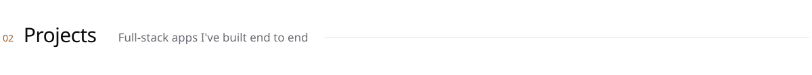
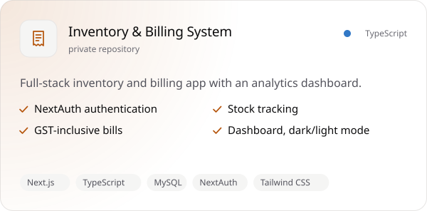
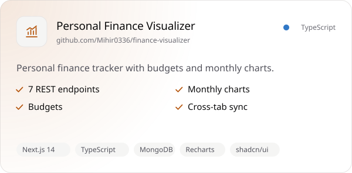
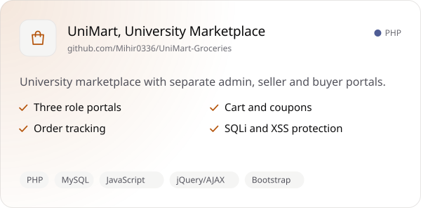
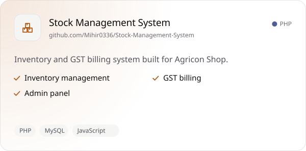
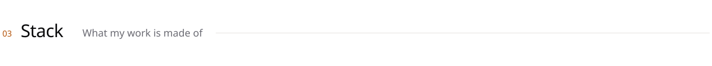
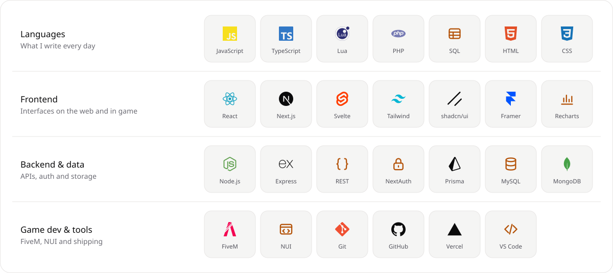
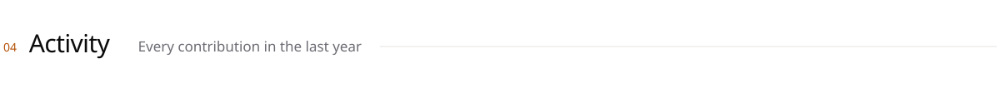

<picture><source media="(prefers-color-scheme: dark) and (max-width: 640px)" srcset="assets/dark/hero.m.svg"><source media="(max-width: 640px)" srcset="assets/light/hero.m.svg"><source media="(prefers-color-scheme: dark)" srcset="assets/dark/hero.svg"></picture>

Next.js, React and TypeScript on the web, 
Lua and NUI inside live GTA V roleplay servers. 
Based in Ahmedabad, open to full-time roles.

<a href="https://www.linkedin.com/in/mihirpatel0336"><picture><source media="(prefers-color-scheme: dark)" srcset="assets/dark/chip-linkedin.svg"></picture></a>
<a href="mailto:mihirpatel0336@gmail.com"><picture><source media="(prefers-color-scheme: dark)" srcset="assets/dark/chip-email.svg"></picture></a>
<a href="https://mihir0336.vercel.app"><picture><source media="(prefers-color-scheme: dark)" srcset="assets/dark/chip-portfolio.svg"></picture></a>
<a href="https://mihir0336.vercel.app/Mihir_Patel_CV.pdf"><picture><source media="(prefers-color-scheme: dark)" srcset="assets/dark/chip-resume.svg"></picture></a>

  

<picture><source media="(prefers-color-scheme: dark) and (max-width: 640px)" srcset="assets/dark/h-projects.m.svg"><source media="(max-width: 640px)" srcset="assets/light/h-projects.m.svg"><source media="(prefers-color-scheme: dark)" srcset="assets/dark/h-projects.svg"></picture>

<a href="https://mihir0336.vercel.app/#projects"><picture><source media="(prefers-color-scheme: dark) and (max-width: 640px)" srcset="assets/dark/proj-inventory-billing.m.svg"><source media="(max-width: 640px)" srcset="assets/light/proj-inventory-billing.m.svg"><source media="(prefers-color-scheme: dark)" srcset="assets/dark/proj-inventory-billing.svg"></picture></a>
<a href="https://github.com/Mihir0336/finance-visualizer"><picture><source media="(prefers-color-scheme: dark) and (max-width: 640px)" srcset="assets/dark/proj-finance-visualizer.m.svg"><source media="(max-width: 640px)" srcset="assets/light/proj-finance-visualizer.m.svg"><source media="(prefers-color-scheme: dark)" srcset="assets/dark/proj-finance-visualizer.svg"></picture></a>
 
<a href="https://github.com/Mihir0336/UniMart-Groceries"><picture><source media="(prefers-color-scheme: dark) and (max-width: 640px)" srcset="assets/dark/proj-unimart.m.svg"><source media="(max-width: 640px)" srcset="assets/light/proj-unimart.m.svg"><source media="(prefers-color-scheme: dark)" srcset="assets/dark/proj-unimart.svg"></picture></a>
<a href="https://github.com/Mihir0336/Stock-Management-System"><picture><source media="(prefers-color-scheme: dark) and (max-width: 640px)" srcset="assets/dark/proj-stock-management.m.svg"><source media="(max-width: 640px)" srcset="assets/light/proj-stock-management.m.svg"><source media="(prefers-color-scheme: dark)" srcset="assets/dark/proj-stock-management.svg"></picture></a>

  

<picture><source media="(prefers-color-scheme: dark) and (max-width: 640px)" srcset="assets/dark/h-stack.m.svg"><source media="(max-width: 640px)" srcset="assets/light/h-stack.m.svg"><source media="(prefers-color-scheme: dark)" srcset="assets/dark/h-stack.svg"></picture>

<picture><source media="(prefers-color-scheme: dark) and (max-width: 640px)" srcset="assets/dark/stack.m.svg"><source media="(max-width: 640px)" srcset="assets/light/stack.m.svg"><source media="(prefers-color-scheme: dark)" srcset="assets/dark/stack.svg"></picture>

  

<picture><source media="(prefers-color-scheme: dark) and (max-width: 640px)" srcset="assets/dark/h-activity.m.svg"><source media="(max-width: 640px)" srcset="assets/light/h-activity.m.svg"><source media="(prefers-color-scheme: dark)" srcset="assets/dark/h-activity.svg"></picture>

<picture><source media="(prefers-color-scheme: dark) and (max-width: 640px)" srcset="assets/dark/activity.m.svg"><source media="(max-width: 640px)" srcset="assets/light/activity.m.svg"><source media="(prefers-color-scheme: dark)" srcset="assets/dark/activity.svg"></picture>

<picture><source media="(prefers-color-scheme: dark) and (max-width: 640px)" srcset="assets/dark/footer.m.svg"><source media="(max-width: 640px)" srcset="assets/light/footer.m.svg"><source media="(prefers-color-scheme: dark)" srcset="assets/dark/footer.svg"></picture>

